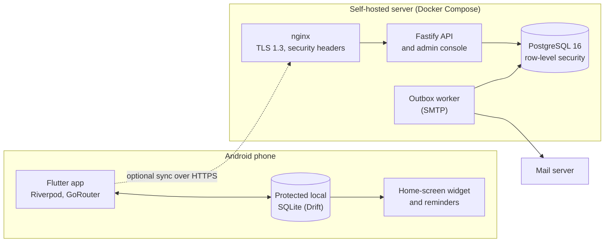

# Simpastil architecture and contracts

This guide describes the API, sync, medication-correctness, projection, and
privacy/logging contracts. Executable tests, generated OpenAPI, and the
implementation take precedence; this page explains the boundaries that must not
be weakened while changing them.

## System boundaries

Simpastil is an offline-first Flutter client (`flutter_app/`) backed by a
Fastify/TypeScript API (`server/`) and PostgreSQL. The supported deployment is
Docker Compose: nginx → API → PostgreSQL, with separate one-shot provisioning
and migration services and a least-privilege outbox worker.

The repository is a monorepo because client and server contract changes must be
reviewed and released together.



The app is fully functional on its own. Sync is optional: the app queues local
changes, flushes them to the API, then pulls server state, and the local
database stays the source for what the phone shows.

## Protected Android care storage

Normal `AppDatabase` opening uses Drift 2.34.0 with sqlite3 3.5.2's maintained
SQLite3 Multiple Ciphers native hook (`source: sqlite3mc`, ChaCha20). Runtime and
generator versions are aligned with the pinned Flutter SDK. Explicit test
executors remain isolated; they do not replace the normal protected opener.
Android stores care generations under `Context.noBackupFilesDir/care`. The
independent random device key is persisted and read back through encrypted
secure preferences backed by Android Keystore. Database access does not require
biometric authentication for every foreground/background connection.

Before any normal executor is handed out, a cross-isolate/engine SQLite gate
coordinates preparation. A legacy source writer reservation protects the
WAL-consistent `VACUUM INTO` snapshot. Plaintext conversion occurs only inside
private staging, outside a transaction, and the encrypted original is reopened
and checked for schema, row counts, logical fingerprint and integrity before
candidate migration. The candidate stays at its final generation path, is
checkpointed/closed and checked, then a flushed marker is atomically replaced
and its parent directory synchronized. Published care is opened without
SQLite's CREATE flag and revalidates required tables, columns and indexes.

Missing/wrong keys, corruption, future schemas/markers, missing established
files, an absent required upgrade source and unknown generations refuse
initialization. No failure resets the key or silently substitutes empty care.
Interruption retries preserve committed active state and immutable original
recovery. Current v3/v4/v5 migrations preserve pending operations, uncertain
effects and sync staging. Legacy duplicate-dose cleanup and missing generated
index repair run only on the unexposed protected candidate. Four legacy
`server_id` partial unique indexes are accepted only after exact-definition
verification; native duplicate/null/primary-key-upsert behavior and a disposable
verification copy check the documented compatibility exception. Future
`server_id` UPSERT conflict targets or foreign-key references must revisit it.

Plaintext retirement binds to the original committed recovery generation,
verifies both protected copies and the original fingerprint, lets SQLite settle
its own journal, closes source handles, then persists deletion intent. It
synchronizes the source parent even on retry after unlink before marking
`retired`. Busy, changed, unavailable or unsynchronized sources remain pending;
surviving legacy sidecars also keep protection health pending.

`ProtectedFileStore` manages the existing protected database/recovery files;
drafts and queues remain inside the care database. Recovery `Checked` requires
actual reopening and bound schema/fingerprint metadata. Inventory reports
measured category sizes and retains unknown values as unavailable. Cleanup
shares the preparation gate, checks active/recovery availability and stale
previews, and removes only proven never-published, unreferenced startup work.
An atomic durable intent and quarantine support partial-deletion retries.
Published care, drafts, queues, current preparation and authoritative/sole
recovery copies are excluded. Live restore must separately drain and close
normal writers before replacing a generation.

The packaged Android manifest disables backup and references exclusions for
all nine storage domains in legacy backup, cloud backup and device transfer.
This backend is validated on Android; it makes no iOS implementation claim.
Portable file backups have a separate password/export boundary from the
device-managed migration recovery described here. See [development checks](../CONTRIBUTING.md)
and [client recovery guidance](../DEPLOYMENT.md#android-client-upgrade-and-local-recovery).

## Portable Android backups and report exports

The version-1 `SIMPBAK1` container supports schema-10 through schema-17 portable documents,
separate from the device-managed SQLCipher key and recovery generation.
`BackupInventory` explicitly classifies every current table and field. It
exports 26 current care/evidence tables (23 for schema 10), including drafts,
original authors, legacy records, uncertainty, pending-operation/effect state
and unmerged staging evidence. Ten device/authority tables are excluded,
including private restore intents, effect settlements and the device-local
`person_first_seen` table; the frozen schema-10 inventory excludes seven. User session generations and
old reminder delivery/readiness proofs are omitted; reminder/privacy choices
remain portable (the Reduce motion switch lives in the allowlisted
`appearance_preferences_v1`). The last viewed workspace is projected independently of
network/device authority. Only an explicit preference allowlist is exported.
Preserved staged cursors are evidence, never permission to resume a live sync.

Full capture first requires current grants for every retained workspace, then
reads a coherent database transaction and rechecks those same grants. An
inaccessible or unresolved workspace blocks Full rather than being silently
omitted. Ownership constraints retain proven deleted-parent evidence and
refuse contradictory or ambiguous ownership. A Full archive can also preserve
narrowly recognized detached historical evidence with no provable owner, after
all retained workspace grants are checked. Those rows receive no invented owner:
Full restore quarantines them as inactive evidence, selected import excludes
them, and later sign-in does not activate them. SQLite count/length preflights and bounded
row reads precede a serialization budget. The current supported limits are
64 MiB of portable content, 200,000 rows, 4 MiB per string and bounded JSON
structure; an unsupported size is rejected without truncating or altering care.
The fixed document shape is scanned before general JSON decoding allocates its
tree. Opaque legacy payloads are retained as factual strings.

Password protection uses pinned `cryptography` 2.9.0: Argon2id with 19 MiB,
two iterations and one lane derives a 256-bit key from a fresh 16-byte salt;
AES-256-GCM uses a fresh 12-byte nonce and authenticates the exact fixed header
as well as the content. Versions, lengths and fixed algorithm/KDF parameters
are checked before expensive work. Byte buffers remain typed; crypto and
container encoding/decoding run outside the UI isolate. No plaintext backup
cache is created.
The explicitly reviewed clear option uses SHA-256 corruption detection; that
checksum does not authenticate an adversarially changed clear file. Neither
an imported author name nor possession of a backup grants account access.
There is no password-recovery bypass.

Android Storage Access Framework chooses one document at a time. Native IO
uses opaque chosen-document tokens, streams bounded reads and writes directly
to that provider, and fails clearly without a foreground chooser. No public
filesystem path or directory-wide grant is assumed. After selection, the exact
captured grants are rechecked immediately before dispatching care bytes. A
write failure after dispatch can leave a partial file and is reported as such.
Saved/unchecked means the completed write could not be reopened. Saved/check
failed means readback was definitively oversized, changed or invalid. Checked
requires exact destination bytes and successful container/document decoding,
with separate capture and check dates. A standalone selected-file check binds
the password prompt to that document, reopens it and refuses a changed source.
Checking does not publish records, preferences, reminders or connections.

Import previews use stable identities, exact values and a captured target
fingerprint; names never establish overlap. Selected local import preserves
the target author/preferences and isolates incoming queues, effects and staging.
Same-ID divergence retains both versions and the whole affected care graph.
Connected originals remain account-scoped evidence: existing authorized care
and grants stay unchanged, locked care is never read for comparison, and new
owner/workspace/origin metadata gets a fresh author and false grant. Neither
import nor later account sign-in recreates archived shared profiles or recording
heads; ordinary current pulls establish the operational connected collection.

Full replacement requires a reviewed target, uninterrupted writer reservation
and an independently reopened encrypted recovery of care and portable preferences
before its single care/receipt/restore-intent transaction. A durable receipt makes
fresh-session retry leave later records intact. Preference reconciliation uses a
separate process-shared barrier and checked idempotent writes, retried before
startup preference caches. Failed writes leave care restored/preferences pending;
unexpected changed preferences require review. Private retirement proofs can clear
old owned OS projections but never grant recording access. Optional notification
or widget failures remain separate from committed care, with durable retry.

PDF/CSV working reports are transient clear files under Android private
no-backup `report-previews`, with unique names. `ReportExportRepository`
captures only the currently granted person/workspace, rechecks access/person
before explicit sharing, and removes its working files in `finally`, including
failed sharing. Generation also cleans partial outputs. The UI receives safe
localized failure text rather than exceptions containing care or private paths.
Reports cannot restore a collection and are not portable backups. Restore,
selected import, lock integration and the final Settings UI have their own
acceptance tests.

## Care workspaces and access

Schema 6 adds protected workspace, author, grant, device selection/reminder,
credential-slot and installation-bound cursor metadata. A standalone workspace
has a `local:` owner bridge for existing foreign keys and a separate stable
workspace author UUID. Neither is an authenticated account or evidence of
historical human authorship. People share that workspace author; selecting a
person changes the viewing filter independently of configured reminders.

Existing account owner IDs and queued work stay intact. Migration marks their
server origin and historical authorship unresolved, without trusting mutable
server preferences. Access requires review of the original HTTPS installation
address plus matching current authentication. The normalized address includes
its base path; a matching owner UUID at another installation cannot adopt care.
Sign-out revokes access durably and retains care, queues and recovery. It does
not remove an unrelated standalone workspace.

Production repositories and streams capture a complete `WorkspaceContext`:
workspace, owner, author, grant epoch and, for connected care, endpoint, session
generation and network epoch. The database checks it before and after each
DB-only transaction, including actual parent ownership. Network and platform
calls stay outside those transactions. A stale callback cannot acquire a newer
grant by looking up the same owner again. Explicit unscoped constructors exist
for legacy isolated test fixtures; production callers pass captured authority.
Local owners are refused by the network operation queue.

Schema 7 adds protected setup drafts and separate reviewed medication details.
Drafts retain their workspace author, fixed person, saved medication and revision
across restart. Person/medication saves and draft progress commit together;
optional platform failures are reported after that commit. A medication save
creates no routine, PRN sentinel or stock event. Package strength and form remain
optional; amount taken is explicitly unknown or an exact decimal/fraction with
its own unit. Original Dosage wording remains intact and unreviewed. Existing
connected payloads are unchanged; additive reviewed details remain local and
the save result states that boundary.

Schema 8 adds append-only local routine revisions with exact millisecond effective
boundaries. Daily multi-time, selected weekdays, anchored calendar intervals and
PRN use one reviewed-zone engine for preview and persisted occurrences. Stable
slot identities preserve recorded and undone entries across clock edits; saves
also reconcile already-materialized future work beyond the preview range. Local
snapshots are additive version 2; connected materializer/snapshot version 1 and
wire payloads remain unchanged. Today, reminders and widgets materialize local
ranges before reading care, and repeated unchanged reads write no new rows.
Optional routine reviews resume in the existing protected setup draft.

Schema 9 adds local recording receipts and explicitly reviewed physical stock
balances. Prepared care actions capture the workspace grant, person, exact entry,
version, reviewed local date, amount and known-or-unknown actual time. Retrying
the same intent returns its durable event; a new as-needed use creates a separate
entry. Local recording needs no server queue. Undo appends a reversal against the
displayed event, including after reopening, and preserves the original facts.
Connected Undo waits for its original command and mapped server event; outgoing
requests are frozen before sending, and a changed server head requires review.
Care saved, sharing, stock and projection refresh have separate outcomes.

Physical stock changes require a reviewed quantity in the same explicit unit;
legacy whole-number stock is retained without an inferred conversion. Corrections
retain both net balance change and attributable consumption, so later corrections
and exact Undo apply once. A later physical review is preserved when Undo cannot
prove a stock reversal. Negative or unreviewed stock does not block care. History
uses captured person and medication snapshots, including removed or moved
medications; historical author and amount remain unknown when evidence is absent.

Schema 15 changes data only. The shipped build never wrote `users` rows, so its
retained care had no workspace after schema 6. The step gives every owner that
retains care but has no workspace its `users` row and an `unresolved` connected
workspace, keeping owner IDs. Sign-in treats any owner with retained rows as
populated, so the original-server review cannot be bypassed. Launch shows a
notice instead of onboarding while such a workspace waits; after sign-in the
review screen calls `confirmOriginalServer`, then the legacy selection picks the
person. Backup documents accept source schema 15 with the schema 14 columns.

Schema 16 adds the device-local `person_first_seen` table, filled by a trigger
when a profile row is first inserted (local create, pull, import or restore) and
backfilled from each profile's own `created_at`, so an upgrade never claims the
phone missed days it may have seen. History uses the earlier of first-seen and
the oldest record to draw days before the people in view reached this phone as
unseen rather than "nothing recorded". The table is never exported or synced.
Schema 17 only widens the pending-operation state CHECK with the terminal
`discarded` state, keeping every row, key, index and effect. Schema 18 only
widens the occurrence ledger CHECKs (`medication_occurrences.state`,
`occurrence_events.action`, `from_state`, `to_state`) to admit the recorded
`missed` state and the `miss` action; both tables are rebuilt with every row,
key and index kept, with foreign keys off (the rebuild would otherwise cascade
away the event history) and with row-count and `foreign_key_check` assertions
afterwards. Backup documents accept source schemas 16 to 18 with the schema 16
inventory. Downgrading below the stored schema fails closed.

Credentials use immutable unique secure-storage slots. Protected device state
publishes the winning pointer after a single-use installation/network
transition; a losing completion can retire only its own unreferenced slot.
Scoped HTTP clients freeze endpoint and capability, reject cross-installation
redirects and revalidate responses before care publication. Sync receipt,
projection and queue acknowledgement share one guarded transaction, preserving
newer local edits and pending work.

Foreground and background refresh share a separate private native gate and
durable attempt receipt. An interrupted or uncertain single-use refresh is not
blindly resent. Servers advertising `refreshRecovery: 1` support a durable
client-generated successor proposal: the exact predecessor/proposal pair can
recover a lost response while the successor remains active. Android flushes
secure preferences before publishing that journal. A different replay still
revokes its family; completed logout and later rotation cannot be undone.
Old servers retain the conservative legacy protocol. See the
[protocol and rollout boundary](decisions/refresh-recovery.md). A definitive rejected refresh revokes its exact captured grant;
installation-key rejection, throttling and transport uncertainty are distinct
from account revocation. Delayed work cannot clear a newer credential pointer.

## API and versioned sync contract

The API is rooted under `/api/v1`. The path prefix identifies the HTTP API
family; sync `contractVersion` is negotiated separately. Existing route-specific
v1 success bodies are preserved. Current registered routes, request/response
schemas, status codes, security, and examples are defined by [generated
OpenAPI](../server/openapi/openapi.json), which is generated from the server and
is not edited by hand.

The API also serves the built admin console (`GET`/`HEAD` of `/`, `/index.html`
and files under `/assets/`) from `ADMIN_CONSOLE_DIR`, which the production image
sets. The built directory is loaded into memory at start and only those exact
paths are routed, so request paths are never resolved against the disk and
traversal is impossible by construction; `/api/` is never shadowed. The console
uses hash routing, so reset and invitation links look like
`https://host/#/reset-password?token=...` and the token is never sent to a
server. Console responses carry a strict `Content-Security-Policy` (same-origin
scripts, styles and connections), `X-Content-Type-Options`, `X-Frame-Options:
DENY`, `Referrer-Policy: no-referrer`, a restrictive `Permissions-Policy` and
`Cross-Origin-Opener-Policy: same-origin`. Every other response, including
errors, carries `X-Content-Type-Options`, `X-Frame-Options`, `Referrer-Policy`
and `Content-Security-Policy: default-src 'none'; frame-ancestors 'none'`.
`Strict-Transport-Security` is set only by the TLS-terminating proxy.

- Contract 1 is the compatibility/bridge surface. While medication-ledger
  activation is inactive, medication writes use atomic bridge commands and
  bridge synchronization is finite and read-only from the client's perspective.
- Bridge commands apply their inventory delta under the server's pill row lock
  and are sent with a null observed base; the result returns the new
  `pillRevision`. Status `pending` is an Undo: it soft-deletes the dose log
  (a `bridge_dose` tombstone) and a retake is a new dose row for the same slot.
  Servers advertise it with the additive top-level capability `bridgeUndo: true`
  (never a contract-version bump); without it the client blocks the Undo with a
  review issue instead of leaving it queued.
- Contract 2 is the active medication ledger and mapped v2 projections. A
  request for an inactive contract receives a typed error; clients must not
  infer or retry with another write contract unless the documented recovery path
  permits it.
- Contract 3 (`medicationCommands: 3`, with the additive `recordedMiss: true`)
  is contract 2 plus the recorded miss: the `miss` action moves one pending
  occurrence to the `missed` state with a zero stock delta (see [Recorded
  misses](#recorded-misses)). It is a superset of contract 2 and needs server
  migration `0023_recorded_miss_state.sql`. A build that speaks contract 3
  accepts `medicationCommands` 2 or 3 and keeps recording misses off against 2;
  a build that only speaks contract 2 reads 3 as "the server moved past this
  app" and reports update required without syncing.
- Capabilities also carry four additive fields about releases and no contract
  version: `serverVersion` (always, the running server's semantic version) and,
  only after a successful daily GitHub check, `latestServerVersion`,
  `latestClientBuild` and `latestReleaseUrl` (a
  `https://github.com/LucaPisl/simpastil/releases/...` page). Clients ignore
  fields they do not know, validate these strictly and treat an invalid value
  as absent. The server never reports a newer-than-running state itself; the
  admin dashboard compares versions and the app compares builds.
- Capabilities also carry the additive `emailReset: "available" | "unavailable"`.
  It is `available` only when the effective password reset mode is email and
  `SMTP_HOST` is set, so an app can offer "forgot password" only where a link
  will actually be mailed. It says nothing about any account and nothing about
  delivery failures; those are visible only to the administrator. The mode is a
  server setting (`server_settings`, migration 0026): `email`, `manual`, or
  unset for automatic. In manual mode `POST /auth/forgot-password` creates no
  token and queues no mail but answers exactly as before, and the administrator
  issues a one-time link with `POST /admin/users/{id}/reset-link`. Issuing any
  new reset link removes the user's older ones.
- The app shows its update card when `latestClientBuild` is above its own
  build. It keeps the last answer in device-local, Dart-only `update_*`
  preferences (not in the backup allowlist), tagged with its source: a
  server answer counts only while a server is configured, and only a phone
  without one asks GitHub itself, at most once a day and only while the person
  has `update_check_enabled` on. It is off by default; once, at the
  first start of a build that has the rule, an install that already held
  preferences and never chose gets it set to on, so existing phones keep the
  behavior they had (`update_check_default_migrated_v1` records that, also
  Dart-only and outside the backup allowlist). A reachable server that
  reports no release clears the stored answer, and a client that the server
  requires to upgrade never shows the card.
- Capabilities report the enforced minimum client build and ledger state from
  deployment authority. Artifact `targetMinimumClientBuild` is immutable release
  metadata and is not the same value as the mutable enforced minimum.
- New v2 errors use a typed, allowlisted envelope with `correlationId`; the same
  bounded value is returned in `X-Correlation-Id`.

Inactive-ledger capabilities retain `medicationBridgeSync: 1` and may add
`medicationBridgeParentSync: 2`. A client opts into medication-bridge contract
2 only when that additive capability is present; contract 1 keeps its existing
response shape and cursor namespace. Contract 2 may attach response-only
`parentSchedule` metadata to a bridge dose whose canonical schedule was omitted
from stable upserts because it is quarantined and inactive, or was represented
only by a deletion tombstone. The snapshot preserves the exact bounded raw
frequency evidence and never creates an active routine. Before materializing
it, the client must map the parent pill and prove that pill belongs to its
captured workspace; the bridge payload alone grants no access. Parent schedule,
dose, and component cursor publish atomically. Missing, mismatched, active,
cross-tenant, or otherwise unverifiable ancestry keeps the component incomplete
and does not advance care freshness.

For an existing synced dose whose exact parent is missing, recovery additionally
requires agreement between its durable server mapping, the v2 change envelope
and legacy source identity, the unchanged schedule ID and scheduled time, and
the incoming revision. Local identity collisions, newer or pending local work,
and contradictory retained legacy owner or pill evidence remain blocked.
The restored parent must pass the same captured-owner
checks before the existing dose guard runs again; recovery never rebinds that
dose. Routine tombstone cleanup retains parents referenced by dose logs or
medication occurrences so preserved history cannot become orphaned again.

Bridge contract3 is separately negotiated by `medicationBridgeAncestorSync: 3`.
For the same historical schedules it includes full `parentProfile` and
`parentPill` stable-shaped snapshots alongside `parentSchedule`, all present or
all absent. The server joins the exact canonical chain under the authenticated
owner, including full deleted ancestors rather than minimal tombstones. The
client validates that owner and identity chain, restores only missing nodes,
and preserves verified local aliases without overwriting existing ancestors.
An already retained historical schedule must match its inactive canonical
identity, fields, revision, deletion state and stored timestamp precision;
ancestor recovery never rebinds it. Pending/newer local ancestors, collisions,
foreign ownership and missing metadata refuse the atomic component commit.
Cleanup retains medications referenced by any routine or occurrence and people
referenced by any medication, including deleted historical rows.

Local schema12 rebuilds only the two sync read-version CHECKs to allow bridge3,
preserving checkpoints, staged items, indexes and foreign keys. Its portable
inventory has the same tables and columns as schema11; schema10/11 decoding
stays supported, and imported bridge3 staging remains evidence without live
sync authority.

Bridge contract4 is separately negotiated by `medicationBridgeOccurrenceSync: 4`.
While the medication ledger is inactive, it adds exact scheduled occurrence
plans to the bridge read view, including doses materialized by already accepted
routine-time reviews. The server retains their canonical medication changes
and rewrites only the response component; bridge1–3 keep their original views.
The first page replenishes the authoritative occurrence window. The client
checks the source identity and captured owner, maps the snapshot's person to
its verified local parent, and preserves locally recorded occurrence heads and
events. Bridge4 retains bridge3 historical ancestor recovery. Local schema13
widens the two read-version CHECKs again without changing care rows or the
portable table inventory; schema10–12 backups remain supported and imported
bridge4 staging remains evidence without live sync authority.

Bridge contract5 is separately negotiated by `medicationBridgePrnSync: 5`,
and its inactive write route by `medicationBridgePrnCommands: 1`. A reviewed
PRN take supplies a client-minted occurrence, event and command identity, the
exact active PRN schedule revision and owner ancestry, reviewed local date and
zone, known-or-unknown actual time, and an explicit administration amount.
The server atomically appends the exact PRN occurrence and event with a
permanent retry receipt while ledger activation remains false. Repeated uses on
one day have distinct occurrence identities. Exact Undo appends a reversal of
the current take head. Neither operation creates inventory evidence or converts
an amount into stock. Contract5 adds only exact PRN occurrences and their
events to the cumulative bridge view; contracts1–4 retain their prior payload
visibility and cursor namespaces. Server migration0017 adds the nullable,
immutable event-level amount detail; older events remain explicitly null.

The server never materializes PRN occurrences, so the same exact PRN take and
Undo stay open after ledger activation; servers advertise this with the
additive top-level capability `ledgerPrn: true`. On an active ledger a take of
a tracked item also appends a `dose` inventory event of -1 and an Undo appends
a `dose_reversal` of exactly what its take moved (nothing for a take recorded
before activation or while untracked). The receipt then adds `inventoryTracked`,
`currentStock` and `pillRevision`, as the ledger command does. The client sends
an active-ledger PRN occurrence through this route only while it has no server
identity; once acknowledged, later commands on it are ordinary ledger commands.
Without `ledgerPrn` such a dose waits in the outbox.

Local schema14 stores explicitly reviewed schedule zones and nullable exact
PRN event amounts, and admits bridge5 without changing existing care or cursors.
Older schedules default to `legacy_unknown`; the device zone is never inferred.
A one-time stable projection replay hydrates authoritative zone fields. Its
marker and cursor publish only with the complete staged merge.

A completed authenticated split-review disposition settles only its linked
original effect. The protected `effect_settlements` audit preserves its exact
workspace, issue, resolution command and request fingerprint. Original effect
states, payloads and delivery uncertainty remain unchanged; the UI distinguishes
reviewed from delivered. An operation leaves actionable counts only after every
effect is acknowledged or explicitly settled. The account projection uses the
server's `medication_split` entity type and a bounded one-time replay to recover
previously acknowledged dispositions missed by older clients. These server-bound dispositions
are excluded from portable backups. A later authoritative legacy projection
may replace only its exactly settled optimistic source; newer pending care or
stable edits remain protected.

Bridge requests are frozen before their first attempt. Retry uses the identical
request. Previously attempted scheduled commands without that evidence are
captured as uncertain for explicit reconciliation, never reconstructed or sent.
PRN take and Undo require an exact causal chain and mapped owned ancestry.
Legacy reminder cleanup checks both the owner's person and medication keys,
including retained tombstones. Native pending requests with the exact old
schedule envelope can also prove an owned legacy alarm when its saved ID list
is missing. A separate device-wide retirement pass handles saved legacy lists
whose parent and schedule identities are both absent: every workspace must be
ready, and the complete care database (including foreign and deleted rows and
server aliases) must contain neither identity. Modern registry IDs and unknown
envelopes remain protected. Care revision and access are checked before each
cancellation; only successfully cancelled IDs leave the legacy list. No dose or
inventory truth is changed. Native swipe-dismiss does not retire repeating
alarms and must not be mistaken for Snooze.

Known rollout errors include `CONTRACT_NOT_ACTIVE`,
`MEDICATION_BRIDGE_REQUIRED`, `MEDICATION_RECONCILIATION_REQUIRED`, stale-update
conflict, and client-upgrade-required. Errors are not success payloads, and a
partial sync result must not be presented as full success. A correlation ID is
safe to share with an operator; it is not an authorization credential.

Password-reset and invitation flows use one configured public origin and
browser-first routes. One-time proofs are carried in the URL fragment, stored
only as validation hashes, consumed once, and delivered through the encrypted
transactional outbox. Never log or paste a raw proof or complete link.

Both user and admin access gates reject any JWT with an own `purpose` property,
regardless of its value. A challenge token is not an access token. See
[`authenticate.ts`](../server/src/plugins/authenticate.ts), the [admin
gate](../server/src/modules/admin/admin.routes.ts), and the [purpose regression
tests](../server/src/test/e2e/token-purpose.test.ts).

Admin console sign-in state is server-side. Every admin access token carries a
`sid` claim that equals the refresh-token family of that sign-in, and the admin
gate also requires that family to have an unrevoked, unexpired refresh token.
`POST /admin/auth/logout` revokes the calling sign-in's family (idempotent,
`204`, audited `admin.logout`), so its access token stops working at once and
its refresh token can no longer rotate. `POST /admin/auth/logout-all` still
bumps the session version and ends every admin session (audited
`admin.logout_all`). An access token issued before `sid` existed has no family
to check and stays valid until its short expiry; a non-string `sid` is
rejected. Two-factor enable, disable and backup-code regeneration also end
every admin session (`GET /admin/auth/2fa/status` reports `available`,
`enabled` and `backupCodesRemaining`, never the secret).

`GET /admin/audit-logs` takes `limit`, `offset`, `action`, and ISO `from`/`to`
bounds and answers `{ logs, hasMore }`. A failed admin sign-in (wrong password
or wrong 2FA code) writes one `admin.login_failed` entry with the time and the
client IP only, never the attempted value. At most one entry is written per
client address per 60 seconds, tracked in memory per API process: replicas each
write up to one per window and a restart forgets the window.

JSON field names are camelCase. `frequencyDays` is an integer array on the wire;
the local Drift representation is JSON text and must be decoded on write and
encoded on pull. Dates are strict calendar dates and paginated inputs are
bounded non-negative integers. Check generated parity with:

```sh
cd server
npm run openapi:check
```

Regenerate intentionally after a route/schema change with
`npm run openapi:generate`, inspect the generated diff, then run the parity
check and contract suite.

## Sync and rollout invariants

Sync is durable, ordered, and component-isolated. The local journal records
intent before sending; remote acknowledgement is distinct from local
completion. Each component reports `succeeded`, retryable/permanent failure,
`blocked`, or `notRun`, with a safe error code and correlation ID. A broad catch
must never turn partial progress into overall success.

1. Flush pending local commands before pulling server changes so offline-created
   entities receive stable server identities first.
2. Pull each component through a finite server snapshot/cursor. Stage pages;
   merge only after the final page succeeds, in one transaction, then advance
   that component's checkpoint.
3. Never overwrite a local row whose `syncStatus != 'synced'`. Preserve unsent
   intent and replay it using its stable command/mutation identity.
4. Apply conflict policy deliberately: server wins for profiles, pills, and
   schedules; local wins for dose logs. Resolve revision conflicts with the
   typed current entity, not blind overwrite.
5. Preserve tombstones and component sequence watermarks. The client stale-reset
   threshold is 88 days; server dose-log tombstones are retained for at least
   90 days. Automatic tombstone purge is currently disabled: token cleanup
   retains medical rows until a separately authorized and verified retention
   path exists.

The artifact target build is 2 while the enforced minimum starts at 1. A build
above the target (build 3 carries recorded misses) is a valid release of the
same target: the release tooling requires `appBuild >= targetMinimumClientBuild`
and the target itself is not raised by it. Keep
enforcement at 1 while the bridge client and remediated server roll out. Ledger
activation is one exclusive audited authority flip, not dual-write mode. Before
activation, reconcile every known transition; ambiguity, contradictory state,
or changed base blocks the operation. After activation, returning offline
devices may adopt an existing effect or apply only a proven native-ledger
residual against the unchanged base; legacy writes never reopen.

Held stock at activation. In bridge mode a stock-setting command (`start`, or a
`correct`) waits on the phone, and bridge doses leave the server count unset, so
the server holds no inventory event for them. When the ledger becomes active the
phone sends its held `start` as the count it shows now minus the effect of the
commands still unsent, so doses already delivered through the bridge are folded
into the opening (the server's opening delta includes them). Once the opening has
committed, those local dose events are marked `foldedIntoOpening`; a failed or
discarded opening marks nothing.

Ordering. Every later dose, undo and correction for that pill waits, without
spending a retry, while the opening can still apply: it is queued, sending,
retrying, or blocked with an unknown outcome (uncertain result, `SYNC_RETRY_EXHAUSTED`,
or awaiting reconciliation: the server may have applied it). A definitive refusal
(400/422) never applied and releases them. The wait is persisted on the held
operation as `INVENTORY_START_PENDING`, and Fix sync problems says so; it counts
as stranded only when the opening is stuck. An opening in conflict (the server
count was already set) or blocked for review will never apply by itself, so it
releases those operations and doses still reach the server. Order is the outbox
insertion order (the table's rowid), not the device clock. The start itself waits
while a command touching the pill is blocked or in conflict (persisted as
`INVENTORY_START_WAITS_FOR_REVIEW`, shown as stranded); an opening with no known
phone count becomes a conflict review item (`INVENTORY_START_STOCK_UNKNOWN`) that
can be discarded or replaced by the server's version.

Pull. While an inventory command for a pill can still reach the server, a pull
keeps the phone's count in any mode. A command in conflict or blocked for review
only does not: the review shows the server's count.

Undo of a folded dose. The app does not offer Undo for a bridge-era dose after
activation: activation creates no head occurrence event for it, so neither the
Today card nor the dose detail shows an Undo. The stock-unchanged handling in
the code is a defensive guard, not a supported path: the server reverses an undo
only when it holds an inventory event for the undone dose, and for a folded dose
it holds none, so it would apply the undo as 0, and the phone does the same (no
stock change, no local inventory event, and a notice that the count was not
changed). Before the opening has committed, an unsent undo is not subtracted
from the opening, so the count the server opens with already reflects it. Limit:
only this phone's doses are folded. If two phones hold a `start` for the same
pill, the first one to reach the server wins (the other gets a conflict) and the
loser's bridge-era doses never became stock events, so they are not counted.
Activate only after every phone has synced.

Recorded-miss rollout gate. Install the build that speaks contract 3 on every
device before deploying server migration 0023: that build still runs against a
contract-2 server (misses off, the setting shows that the server cannot record
them), whereas a build that only speaks contract 2 stops syncing as soon as the
server advertises `medicationCommands: 3`. After the deploy, confirm
`GET /api/v1/capabilities` reports `medicationCommands: 3` and `recordedMiss:
true` before relying on the setting. Old and new clients never share a miss: the
gate is the capability version, not the enforced minimum build.

Raise the enforced minimum only after rollout proof. The privileged command
requires a non-secret change reference and cannot exceed the immutable artifact
target. Compatibility mode may bypass only minimum-build rejection; it cannot
lower ledger activation or restore legacy writes. Rollback uses the remediated
compatibility image on the current schema. Never down-migrate, edit authority
rows manually, or perform dual writes.

### Stable entity mutation outcomes

Profile, pill and schedule writes are keyed by the body `mutationId`; every
outcome below is part of the contract.

- Replaying the same `mutationId` with identical input returns the stored
  result. Reusing it with different input, or for another operation or entity,
  is `409 CONFLICT_MUTATION_REUSE`.
- Deleting an entity that is already soft-deleted (same user, same entity) is
  `204` under any `mutationId` and any `baseRevision`. It records a receipt so
  replays are stable and appends no second tombstone. A live row with a stale
  revision stays `409 CONFLICT_REVISION`; an unknown or foreign id stays `404`.
- Updating a soft-deleted entity is `404 RESOURCE_NOT_FOUND`, with the tombstone
  in `details.currentEntity` (`deletedAt` set).
- Creating with an id that already exists for the same user is
  `409 CONFLICT_DUPLICATE` with `details.existingId` and `details.currentEntity`
  (including a tombstone), so the client adopts the row. A foreign or
  unreadable row discloses nothing.
- A sync page that fails its own response schema is `500 SYNC_PAYLOAD_INVALID`,
  never `400 VALIDATION_ERROR`. The server log names only the component and the
  offending `serverSequence`.

## Medication correctness

Medication state is modeled around immutable occurrences and auditable commands,
not by rewriting past doses from today's schedule.

- Local row IDs, server entity IDs, occurrence IDs, and command/mutation IDs are
  different identities and must not be substituted during merge or retry.
- Scheduled occurrences retain a stable key, schedule revision/snapshot, planned
  local date/time, IANA timezone, resolved instant, and provenance. Ambiguous
  DST time uses the earlier offset; nonexistent local time advances to the first
  valid instant while retaining the intended wall time. Legacy reconstructions
  without exact source timing remain explicitly estimated and must never be
  relabeled exact.
- Once due, an occurrence's historical snapshot is immutable. Schedule edits
  affect future occurrences only.
- Dose and inventory events are append-only. Corrections/undo are linked
  compensating events, not destructive edits.
- Dose state and stock deltas commit atomically under a stable command identity.
  Retries return the original receipt. Compare-and-swap revisions prevent stale
  absolute updates. Negative stock is surfaced for reconciliation; it is not
  silently clamped and must not prevent recording a taken dose.
- Daily and PRN schedules have no weekday array. Weekly/custom schedules require
  valid, non-empty, unique ISO weekdays. Invalid migrated schedules are
  quarantined rather than guessed. PRN entries require an explicit date; a
  missing PRN time remains explicitly unknown.
- Adherence is one reducer: taken due scheduled occurrences divided by all due
  scheduled occurrences. Skipped, missed and not recorded remain visible as
  separate outcomes; PRN is excluded from the expected-occurrence denominator.
- "Missed" is a recorded state, never an inference. A due dose nobody recorded
  stays pending and reads "Not recorded" in Today, history, adherence and
  exports until a `miss` event says otherwise; the clock alone never turns it
  into a miss, in the app or in the widget.

### Recorded misses

When Settings > Reminders > "Record missed doses" is on, the app
appends a `miss` event for a scheduled, expected, exact, pending occurrence once
`plannedAt` plus the chosen delay has passed. The setting is on unless someone
turned it off (an absent preference counts as on), and the delay defaults to 60
minutes, separately from the 15-minute snooze default. It is an ordinary append-only
ledger command (origin `auto` stays client-only and is never on the wire):

- `miss` moves `pending` to `missed` with a zero stock delta. The server answers
  422 `MISS_NOT_ALLOWED` unless the occurrence is scheduled, expected, exact, not
  superseded and due (`plannedAt` at least one minute, the smallest delay
  setting, less a 30 second clock-skew tolerance, before the server's now), and
  409 `CONFLICT_STALE_UPDATE` if it
  is no longer pending. A refused or stale automatic miss is dropped silently on
  the device; a person who acts on the dose first withdraws an unsent miss.
- `take` or `skip` on a missed dose is stored as a `correct` event from
  `missed` (a take is "Taken (late)", recognised by `correct` from `missed`;
  the take carries the usual -1 stock delta, the skip 0). Undo applies only to
  the current head: undoing a late take returns to `missed` (+1 stock), undoing
  the miss returns to `pending`. A `correct` target state is never `missed`.
- The command ID is a UUIDv5 of the owner and the occurrence key only, so a
  retry or a second run on one device cannot write a second miss. Workspace IDs
  are minted per installation and are deliberately not an input: two devices
  that mark the same dose send an identical command, and the server answers the
  second with the stored receipt, which the client treats as success. Exactly
  one miss exists either way.
- The sweep looks back only at occurrences due after the setting was switched on
  or, with no stored moment, after the first sweep that sees the person (the
  device-local preference `auto_miss_since_$userId`, never exported or backed
  up), so a new install never back-fills a burst of misses. It is capped at
  7 days and 200 doses per person and run. It runs on resume, every minute
  while the app is open, after a protected sync and from a periodic WorkManager
  task that needs no network, so a local workspace records
  misses offline. Against a server below contract 3 nothing is recorded and
  `since` advances, so an upgrade never lands a burst.
- Turning the setting off stops new misses; it never undoes existing ones. Every
  miss reads "Marked missed automatically", has an entry time only (no actual
  time, author or amount) and is visible on every device after sync.

Relevant implementation and coverage include the [occurrence
materializer](../flutter_app/lib/core/medication/occurrence_materializer.dart),
[materializer tests](../flutter_app/test/core/medication/occurrence_materializer_test.dart),
[command tests](../flutter_app/test/core/medication/occurrence_reducer_test.dart),
and [server component-sync tests](../server/src/test/e2e/component-sync.test.ts).

Schema 10 adds protected, device-only reminder settings and per-schedule choices.
The existing migrated person reminder choices remain authoritative; viewing a
person or Everyone never changes alert eligibility. One alert at the planned
instant is the default. Explicit positive follow-up offsets have distinct stable
projection IDs and the same exact occurrence/version target. Disabled schedules,
completed/superseded entries and expired alerts are retired without replaying the
past; losing exact-alarm permission does not prevent proven stale cancellation.
Full notification details are the default. Reduced-identification notifications
show generic text and Open; no care-changing shortcut is shown without a visible
target. These device choices never enter a server queue.

## Session-bound projections

The database and synchronized occurrence state are authoritative. Notifications,
widgets, dashboard, and history are rebuildable projections and must not become
a second source of medication truth.

Projection version 2 carries workspace, owner and grant epoch. Legacy owner and
generation mirrors remain wire compatibility fields, never access authority.
Logout/account replacement revokes the old grant before retiring its effects.
Background work freezes full care/network authority before requests and checks
it at publication. Optional platform initialization does not block care startup.

Reminders are occurrence-specific projections with stable identity. Reconcile
after committed schedule/occurrence changes, serialize competing refreshes, and
recheck the complete grant and live person/occurrence parents before and after
OS publication. A private cross-engine effects gate is separate from care
transactions. The registry separates reminder, snooze, stock and readiness-test ownership,
refuses unknown/future metadata and cancels only proven captured effects.

Self-healing: a single-flight runner coalesces reconcile triggers (resume,
post-sync, background) into one run plus one rerun, retrying a busy result with
bounded backoff. After a pass, an audit cancels pending reminders that are
neither desired nor protected (low stock, readiness test, anything armed in the
last 60 s per a bounded id ledger, `reminder_id_ledger_v1`), including legacy
payload shapes, and keeps one shown notification per occurrence and kind. A
workspace signed out on this phone is skipped and does not block the audit; a
workspace that failed to reconcile is held out and keeps its alarms until a
retry succeeds; an occurrence that cannot be projected is counted, not fatal.
The first complete pass of a new build also clears legacy `notif_ids_*` lists.
A projection id collision takes a deterministic probe id that stays recorded in
the registry for as long as the reminder exists (a new, lower projection never
moves an armed one). Retired notification channels are deleted only after a
complete, fully successful audit that left no reminder pending or wanted on
them, with the grants rechecked. A failed or busy reminder pass after a
Taken/Skip action is retried in place and then handed to a one-off WorkManager
task. That task is queued with `ExistingWorkPolicy.keep` and is bounded: it
reports success unless the effects gate was busy (or the pass threw), repeats
only up to three attempts counted in preferences, and treats signed-out,
unready or degraded passes as final. While any workspace is failed, the audit
does not remove alarms that name no owner; a complete pass does. Settings > Reminders > Reset reminders (also linked from
Fix sync problems) cancels the reminder alarms and every id the ledger and legacy lists
remember, keeps pending snoozes, low-stock alerts and the readiness test, wipes
the reminder registry entries and ledger, rebuilds through the runner (retrying
in the background if the first attempt is unhealthy) and rechecks low stock. Reset refuses, and cancels nothing, when the reminder
registry is unreadable, because snoozes cannot be told apart without it.
The last audit's counts are shown under the Reset row.

Initialization requests no notification, exact-alarm or battery permission.
The readiness service exposes an explicit foreground access request and test;
requested, permission allowed, successfully scheduled and user-confirmed observed
facts remain separate. Plugin failure/unknown permission never becomes Allowed
or observed delivery. A restore invalidates the device delivery check. A committed
care/device-choice watcher coalesces optional phone refreshes independently of
care save, while startup/resume/midnight rebuilds and Android's existing boot
receiver restore future alerts. The watcher and callback flows use the same
protected reconciler; native delivery on the user's phone remains unverified
until the user confirms the scheduled check.

A missed dose is retired like any recorded one: reminders, follow-ups and
snoozes require the occurrence to be `pending`, so a miss cancels them on the
next reconcile and later "Taken (late)" or Undo schedules nothing in the past.
Widget rows for missed doses are display-only (no Take action), because
notification and widget actions require `pending`.

Notification and widget actions carry the delivered occurrence state version
as well as the full projection identity. A pending slot after Undo requires a
new delivery; an old delivery cannot create a second recording. Durable replay
IDs are shared by Dart and Kotlin. Legacy payloads remain parseable for
navigation but cannot mutate protected care. PRN widget summaries are
display-only.

Reminder buttons (Taken, Snooze, Skip) record in a headless engine and leave the
app closed while app lock is off; only tapping the notification body opens the
app. A headless engine cannot unlock, so while app lock is on the buttons open
the app to the dose review screen instead, and nothing is recorded until the
person confirms there. The choice is stored with each reminder as
`actionPresentationVersion` (1 opens the app, 2 is silent), so a change of the
lock policy re-publishes pending reminders and rewrites the ones already in the
tray; an unreadable policy counts as locked. The headless engine pings the
visible app through `ForegroundCareSignal` (an `IsolateNameServer` port) after
it finishes, because Drift change notifications belong to each connection and
an app already on screen would otherwise keep showing the dose as pending.

Tapping a reminder's body opens that dose only after the same read the dose
screen makes succeeds for the workspace the reminder was published for. A dose
that was deleted, belongs to an earlier sign-in, or cannot be read opens Today
instead of the dose screen's "Care is temporarily unavailable" error.

Widget snapshots publish the supported complete marker last. Body, mirrors and
marker must agree before native labels/actions render. Retirement persists an
exact intent before clearing and consumes it only after successful native
refresh, so interruption is retried without blanking a newer workspace. Old
foreground completions cannot restore rows after a workspace/day change.
Unsupported notification locales fall back to English. Schedule time uses the
explicit IANA zone and the DST rules above.

These Dart/Kotlin preference keys are a wire contract:

| Key | Role |
| --- | --- |
| `today_doses` | Dart snapshot writer and Kotlin widget reader; current-day doses |
| `snapshot_day` | Dart snapshot writer and Kotlin widget reader; snapshot local day |
| `widget_projection_identity_v2` | Complete supported workspace/owner/grant publication marker |
| `widget_projection_retirement_v2` | Durable exact retirement intent until native refresh succeeds |
| `app_theme_mode` | Dart preference and Kotlin widget reader; theme mode |
| `prn_in_stats_$userId` | Dart-only, user-scoped PRN statistics preference |
| `prn_in_widget_$userId` | Dart-only, user-scoped PRN widget preference |

The constants are in [`preference_keys.dart`](../flutter_app/lib/core/storage/preference_keys.dart).
Cross-runtime behavior is covered by the widget and notification tests under
`flutter_app/test/` and `flutter_app/android/app/src/test/`.

## Logging and privacy

Logs are operational metadata, not a second copy of account state. Every line
is one JSON object with a fixed `event`, a fixed English sentence in `msg`, and
bounded fields. The sentence is built only from the validated fields, so it can
say what happened without ever carrying free text; the fields stay the
machine-readable record. For example:

```json
{"event":"request.error","msg":"Request failed: 500 INTERNAL (database error 40001 at dist/modules/pills/pills.service.js:88) on POST /api/v1/pills","correlationId":"…","statusCode":500,"errorCode":"INTERNAL","causeKind":"postgres","causeCode":"40001","where":"dist/modules/pills/pills.service.js:88"}
```

`SafeLogger` accepts only `request.error`, `request.complete`,
`correlation.rejected`, `update.available`, `update.check_failed`,
`readiness.not_ready`, and `readiness.recovered`, with the bounded fields
`correlationId`, `method`, `route`, `statusCode`, `durationMs`, `errorCode`,
`retryable`, and `readinessReason` (a closed list), plus for update events
`currentServerVersion`, `latestServerVersion`, `latestClientBuild`, and
`releaseUrl` (a validated project release page). Values are validated before
reaching the sink. `update.available` is logged once per daily check that finds
a newer server release; operators may rely on its field names.

**Failure causes.** A failure is explained by `describeFailure`
(`server/src/lib/failure-cause.ts`), which returns only closed or
pattern-checked fields and never the exception message:

| Field | Meaning |
| --- | --- |
| `causeKind` | `postgres`, `network`, `smtp`, `config`, `validation`, `timeout`, `bug` (a `TypeError`-class defect) or `unknown` |
| `causeCode` | A PostgreSQL SQLSTATE (`40001`), a symbolic system code (`ECONNREFUSED`), or an SMTP reply code (`550`) |
| `errorClass` | The error's class name, such as `PostgresError` |
| `where` | `dist/…:line` of the first stack frame inside this server, never a dependency |
| `configVariable`, `configProblem` | The environment variable a startup error names and `required`, `blank`, `invalid` or `unreadable` |
| `validationPath` | The first invalid request field, such as `items[].amount` (array positions collapsed) |

`where` names the compiled file in the image; `dist/modules/x.js` is built from
`src/modules/x.ts`. The reader follows `.cause` wrappers, so a database error
under a query wrapper still reports its SQLSTATE. The `where` frame is read only
from the stack text after the error message, so text inside a message cannot
forge a location. Request errors with a status below 500 carry only the code
and class.

**Process lines** (startup, shutdown, background jobs, one-shot commands) use
`logProcessEvent` and `logProcessFailure` (`server/src/lib/process-log.ts`). The
event names are `process.crashed`, `process.shutdown_started`,
`outbox.worker_start_failed`, `outbox.worker_run_failed`, `outbox.idle_no_smtp`,
`outbox.sent`,
`outbox.retry_scheduled`, `outbox.failed_permanent`, `outbox.expired`,
`outbox.finalization_failed`, `provision.runtime_posture_verified`,
`provision.runtime_roles_ready`, `provision.command_failed`,
`token_gc.tenant_purge_failed`, `token_gc.periodic_purge_failed`,
`token_gc.initial_purge_failed`, `deployment_manifest.export_failed`, `premigrate_backup.failed`,
`scheduled_backup.started`, `scheduled_backup.disabled`,
`scheduled_backup.created`, `scheduled_backup.failed` and
`scheduled_backup.crashed`. A failure line carries the same cause fields; a
caller-supplied `msg` is ignored. Every entrypoint (API, outbox worker,
`migrate`, `provision`, and the manifest and backup commands) installs
`installProcessGuards`, so an uncaught exception or unhandled rejection ends in
one `process.crashed` line with its cause and exit code 1, not Node's raw stack
trace and message.

**Readiness.** `GET /api/v1/health/ready` still answers only `ready` or
`not_ready`. The server logs `readiness.not_ready` with a `readinessReason`
once when the answer changes (and again if the reason changes) and
`readiness.recovered` when it clears, so a probe every few seconds does not fill
the log. Reasons: `database_unreachable` (with its cause), `migrations_unreadable`
(the journal bundled in the image cannot be read), `runtime_role_unsafe`,
`migrations_behind`, `migrations_incompatible`, `release_mismatch`, and
`contract_not_ready`. The probe's pass and fail decision is unchanged.

**App problem report.** The app keeps a small local log and can turn it into a
plain-text report that a person sends on purpose. Nothing leaves the phone by
itself.

- *Local log* (`flutter_app/lib/core/diagnostics/`): `DiagnosticsRecorder`
  appends one JSON line per event to the app's private support directory
  (about 64 KB per file, one older file kept, one pair per isolate). An event is
  a closed `DiagnosticKind` plus an error type, a short code, a library name and
  up to three `file.dart:line` frames; never the exception message. A tiny
  session marker (`SessionMarker`) records whether the app was in front when the
  process last stopped, so a crash the app could not log is still noticed on the
  next start, and Android's `ApplicationExitInfo` adds the reason (for example
  `EXIT_CRASH`).
- *Report* (`flutter_app/lib/core/diagnostics/report/`): `DiagnosticReport`
  renders `simpastil-report-v1` from typed facts. The report is **public-safe**,
  because GitHub issues are public: it is built from an allowlist, not filtered
  afterwards. Counts are buckets (`0`, `1`, `2-5`, `6+`), ages are buckets,
  times are rounded to the hour in UTC, and the file name carries the date and
  hour only. It never holds a server address or host, an email or account,
  tokens, names, doses, notes, exception messages or a persistent identifier.
  [`contracts/diagnostic-report-v1.json`](../contracts/diagnostic-report-v1.json)
  fixes every section, key and value pattern, and
  [`contracts/fixtures/diagnostic-report-v1.txt`](../contracts/fixtures/diagnostic-report-v1.txt)
  is the golden output; the tests validate generated reports line by line and
  feed hostile text through every field. Change the contract, the fixture and
  the tests together.
- *Sync lines* carry the stage, status, code, HTTP status, retries, a rough
  duration and the request's `correlationId`. That random identifier is the same
  `correlationId` the server writes in `request.error` and `request.complete`,
  so a maintainer can find the matching server log line without learning who the
  user is.
- *Delivery* (`flutter_app/lib/features/report/`): Settings > About > Report a
  problem shows exactly the text that will be shared. **Submit issue on
  GitHub** saves the file to Downloads, explains the steps and opens the
  prefilled issue form (`.github/ISSUE_TEMPLATE/bug_report.yml`; a link cannot
  carry a file, so the person attaches it). **Share another way** saves to
  Downloads, writes an email to the maintainer with the file attached, or hands
  the file to any other app. The same file is used for every route. The report
  is also offered from a card on Today the first time after the app closed
  unexpectedly, and from the sync details when a sync has failed.

Never log passwords, JWTs, API keys, reset/invitation links or fragments, email
content or recipients, request/response bodies, arbitrary headers, profile/pill
names, schedules, dose events, inventory, or unbounded exception/request
objects. For support, send the app's problem report (Settings > About > Report a
problem), or provide the correlation ID, approximate time, app/server release,
and short symptom description—never an account export or medication payload.

Operators choose the shortest log retention that meets incident-response and
legal obligations, document the duration and access owner, restrict access, and
keep exports private. A database/audit retention choice does not automatically
define log retention.

## Evidence and authority

- Generated API: [`server/openapi/openapi.json`](../server/openapi/openapi.json)
- API and error contracts: `server/src/test/contracts/` and `server/src/test/e2e/`
- Sync: `server/src/test/e2e/component-sync.test.ts`,
  `flutter_app/test/core/sync/`
- Projections: `flutter_app/test/core/widget/` and
  `flutter_app/test/core/notifications/`
- Privacy: `server/src/lib/safe-logger.test.ts` and
  `server/src/test/e2e/error-contract.test.ts`
- Problem report: `flutter_app/test/core/diagnostics/` and
  `flutter_app/test/features/report/`

Update this page when a current technical contract changes.
